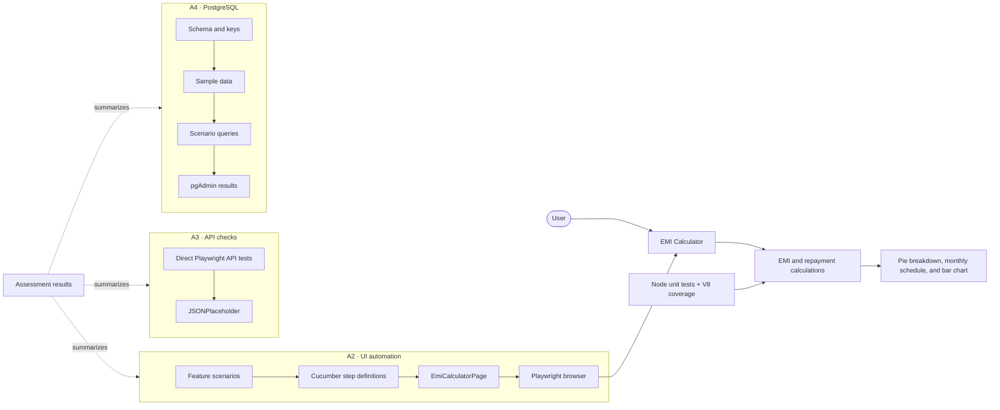

# ClearPlan EMI Calculator — Streamhub Section A

This project implements **Option A / Section A** of the Streamhub assessment. It includes a responsive EMI application, pure calculation logic with unit coverage, Playwright + Cucumber browser tests, direct JSONPlaceholder POST boundary checks, and PostgreSQL scenarios with reproducible sample data.

## Project map



Project files: [calculator](app/page.tsx) · [calculation module](lib/emi.js) · [unit tests](tests/unit/emi.test.cjs) · [UI features](features/emi-calculator.feature) · [API tests](tests/api/posts.spec.ts) · [SQL evidence](sql/README.md) · [latest results](artifacts/assessment-results.md).

## Setup and run

Requirements: Node.js 20+, npm, and a browser supported by Playwright.

```bash
npm install
npx playwright install chromium
npm run dev
```

Open `http://localhost:3000`. The Home Loan tab defaults to 25 lakh, 10%, 10 years. The Personal Loan tab defaults to 10 lakh, 12%, 5 years. Inputs update the EMI, repayment summary and charts. The displayed payment uses the standard reducing-balance formula, with principal converted from lakh to rupees.

## Assessment coverage

| Requirement | Implementation |
| --- | --- |
| A1 dashboard, input-driven report, chart | `app/page.tsx` and `lib/emi.js`: independently tested calculator, summary metrics, chart, and monthly schedule |
| A2 framework and UI tests | `features/emi-calculator.feature`, `tests/steps`, `tests/pages`, `cucumber.cjs`; unit coverage is in `tests/unit` |
| A3 JSONPlaceholder POST boundaries | `tests/api/posts.spec.ts` sends requests directly to the specified public endpoint and records known provider mismatches |
| A4 PostgreSQL | `sql/schema.sql`, `sql/sample-data.sql`, and two PostgreSQL scenario queries; pgAdmin evidence instructions are in `sql/README.md` |

Start the app with `npm run dev` in one terminal. Then run `npm run test:unit` for the calculation logic, `npm run test:api` for direct JSONPlaceholder checks, `npm run test:ui` for Cucumber browser journeys, or `npm run test:all` for all three. Unit tests print a V8 coverage summary. UI tests write `artifacts/ui-report.html`; API tests write `artifacts/api-report/`.

## UI framework design

Feature files describe behavior; Cucumber step definitions coordinate actions; `EmiCalculatorPage` encapsulates accessible role, label and test-id locators. Environment-specific application URL is configured with `APP_BASE_URL` (defaults to `http://127.0.0.1:3000`). API tests use Playwright's request fixture directly against `https://jsonplaceholder.typicode.com`.

## Locator self-healing exercise

`features/locator-self-healing.feature` contains three intentionally broken locator cases, tagged `@self-heal`; the standard run excludes this tag. The assessment asks that these incorrect examples remain broken. To demonstrate their failures, run `npm run test:self-heal`. The detection, prompt, review, and validation workflow is documented in [docs/locator-self-healing.md](docs/locator-self-healing.md).

## API test notes

The API tests target `POST https://jsonplaceholder.typicode.com/posts` directly, as requested. The valid-post case expects `201`. Invalid-input cases assert the requested client-error behavior and are marked as known provider mismatches so the suite reports them without hiding the defect. In the direct check on 2026-11-03, JSONPlaceholder returned `201` for the oversized title, NUL character, and missing `userId`, and `500` for malformed JSON. These expected failures are provider behavior, not local validation results. If the provider begins rejecting an invalid input correctly, Playwright reports an unexpected pass so the known-issue marker can be removed.

## SQL

PostgreSQL is the A4 database. See [sql/README.md](sql/README.md) for the table schema, primary and foreign keys, pgAdmin run order, expected outputs and screenshot checklist. The four normalized tables are `transfers`, `ipl_matches`, `ipl_players`, and `ipl_player_match_performance`. The compact fixture demonstrates the scenarios; full-season IPL results require the complete schedule and player-performance records. The SQLite script is only a supplemental local fixture check, not the A4 database evidence.

## AI pairing reflection

AI was useful for scaffolding the feature, step-definition, and page-object structure, but I checked its output against the brief and the running application. For example, an early chart used a linear balance decline; I replaced it with a reducing-balance amortization schedule and verified the first tooltip and schedule values independently. An initial API wrapper made our own validation pass while masking JSONPlaceholder's behavior; I removed that wrapper and changed the tests to call the provider directly, preserving its observed 201/500 mismatches as known failures. I also removed leftover dark-pattern audit modules and dependencies because they were unrelated to this assessment. Locator suggestions are reviewed against the DOM and accessible names before use; the three deliberately brittle examples remain broken because the assessment asks for them to be left broken.

## Test execution results

Latest local run: see `artifacts/assessment-results.md` for current run status. The API suite requires internet access; the UI suite requires Chromium and a running local server. Playwright HTML reports are generated locally by the test commands. The [GitHub Actions workflow](.github/workflows/assessment.yml) runs typecheck, unit coverage, build, direct API checks, and the standard Cucumber suite.
